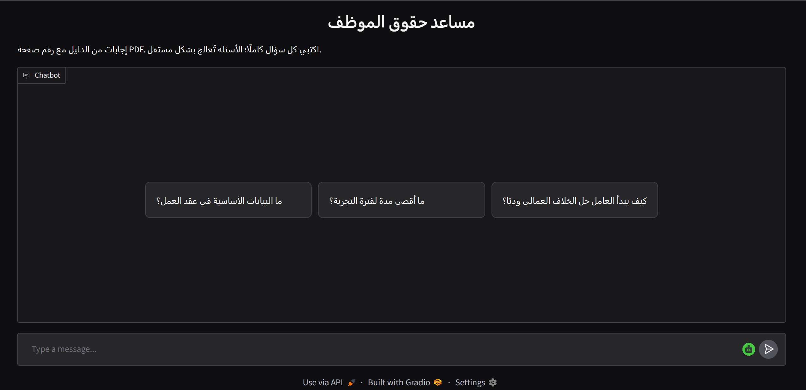
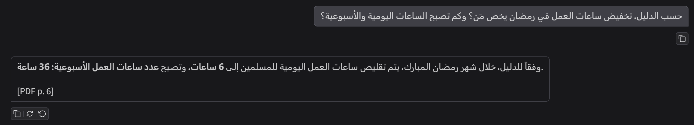

# Arabic Employee Rights Assistant

My capstone project for the **Applied NLP Engineering** course at **SDAIA Academy**.

An Arabic assistant that answers employee rights questions using an official guide, with references to the supporting PDF pages.

**Course Repository:** [SDAIA Academy — Applied NLP](https://github.com/SDAIAAcademy/applied-nlp)

---

## Project Information

| Item | Details |
|---|---|
| Project Type | Arabic Question Answering using Retrieval-Augmented Generation (RAG) |
| Course | Applied NLP Engineering — SDAIA Academy |
| Main Goal | Help users find information in an employee rights guide |
| Data Source | Official HRSD employee rights guide |
| Document | 32 PDF pages |
| Indexed Data | 77 text chunks |
| Main Method | Dense retrieval with Chroma and grounded answer generation |
| Baseline | BM25 retrieval |
| Interface | Gradio running from Google Colab |
| Final Output | An Arabic answer with PDF references, or an insufficient-information response |

---

## Project Overview

This project uses an official Arabic employee rights guide to answer questions about contracts, working hours, leave, probation, and workplace responsibilities.

Instead of sending the whole document with every question, the system retrieves relevant text chunks and sends them to a language model. The model is instructed to answer from the provided text and include the supporting PDF page numbers.

---

## Problem

Finding a specific answer in a long document can take time, especially when users ask in everyday Arabic instead of using the document's wording.

The goal is to make the information easier to find and understand while showing its source. When the retrieved text does not provide enough information, the assistant should say so.

The assistant does not connect to company HR records or access personal employee information.

---

## Data Source

The document used is **دليل توعوي بالحقوق والواجبات لأصحاب العمل والعمال**, published by the Ministry of Human Resources and Social Development.

[Official Guide — PDF](https://www.hrsd.gov.sa/sites/default/files/2025-12/dlyl-tw-wy-balhqwq-walwajbat-lashab-al-ml-wal-mal.pdf)

The file contains 32 PDF pages. Indexing starts at PDF page 5, after the introductory pages.

Citations refer to the page number in the PDF viewer, which may differ from the printed page number inside the guide.

---

## Inputs and Outputs

| Component | Input | Output |
|---|---|---|
| Embedding Model | Document chunks or a question | One 1,024-dimensional numerical vector per text |
| Dense Retrieval | Question embedding | Top 3 chunks with source metadata |
| Generation Model | Question, retrieved context, and instructions | An Arabic answer with citations, or abstention |
| Chat Interface | A complete Arabic question | The answer or a service-status message |

The embedding model represents text for search. The generation model writes the answer.

Each question is processed independently; previous messages are displayed but are not passed to the model.

---

## Documentation

Detailed documentation is separated into the following files:

- [Methodology and Model Settings](methodology.md)
- [Evaluation and Error Analysis](evaluation.md)

---

## Methodology Summary

| Process | Description |
|---|---|
| Text Extraction | Extracted PDF text using PyMuPDF and retained page numbers |
| Text Cleaning | Removed Arabic elongation and repeated whitespace |
| Chunking | Created chunks of up to 400 characters with 100-character overlap |
| Embeddings | Converted the 77 chunks into numerical vectors |
| Storage | Stored text, vectors, and source metadata in Chroma |
| Retrieval | Retrieved the top 3 chunks using cosine distance |
| Generation | Generated an answer from retrieved context with page references |
| Evaluation | Compared BM25 and dense retrieval and manually reviewed answers |

No model was trained from scratch or fine-tuned.

---

## Baseline and Results

**BM25** was used as the baseline. It ranks chunks using lexical matching.

**Dense retrieval** compares embeddings to retrieve text with a similar meaning.

Both methods were evaluated using the same chunks and 15 development questions.

| Method | Questions | Page Hit@3 |
|---|---:|---:|
| BM25 | 15 | 100% |
| Dense Embeddings | 15 | 100% |

**Page Hit@3** measures whether at least one of the top three chunks comes from a reference page.

Both methods achieved the same result on this sample. These scores measure page retrieval, **not final answer accuracy**.

Manual testing identified a working-hours answer that mixed daily and weekly values despite citing the correct page. Formatting the extracted value/label pairs corrected the numbers in a later test. Some conditions can still be omitted.

See [Evaluation and Error Analysis](evaluation.md) for details.

---

## Interface and Example Outputs

### Chat Interface

### Answer with a Source

The assistant identified who the Ramadan reduction applies to and included the daily and weekly hours with a PDF reference.

### Saudi Dialect Question

The assistant answered a probation question written in Saudi dialect and included the supporting page.

### Missing Personal Information

The assistant did not invent a personal leave balance when the guide did not contain that information.

These screenshots show individual development tests, not a comprehensive measure of answer quality.

---

## Tools and Libraries

The OpenAI Python SDK is used to access Liquid models through OpenRouter.

---

## How to Run

1. Open the notebook using the **Open in Colab** button above.
2. Run the installation and import cells.
3. Add your OpenRouter key to Colab **Secrets** as `OPENROUTER_API_KEY` and enable notebook access.
4. Download the official guide and upload it through the notebook's upload cell.
5. Run document preparation, embeddings, storage, and function-definition cells in order.
6. Run the baseline and comparison cells to reproduce the evaluation.
7. Run the Gradio installation and interface cells, including `demo.launch()`.
8. Enter a complete question in the chat.

A GPU is not required because the models run through API calls. Keep the Colab runtime active while using the interface.

Do not include the API key in the repository. Repeated questions and evaluation runs consume API quota. A `429` error may indicate a per-minute or per-day limit.

---

## Limitations

- Evaluation used a small development set from one document.
- Correct page retrieval does not guarantee a correct answer.
- PDF extraction and chunk boundaries can disrupt tables and conditions.
- Citations and factual support are not automatically validated.
- The assistant cannot access personal HR information.
- The interface depends on the Colab session and API availability.

More details and possible improvements are included in [evaluation.md](evaluation.md).

---

## Course Reference

This project applies the concepts and instructor examples covered in **SDAIA Academy's Applied NLP Engineering course**, including embeddings, semantic search, RAG, evaluation, and Gradio.

- [SDAIA Academy](https://github.com/SDAIAAcademy)
- [Applied NLP Course Repository](https://github.com/SDAIAAcademy/applied-nlp)
